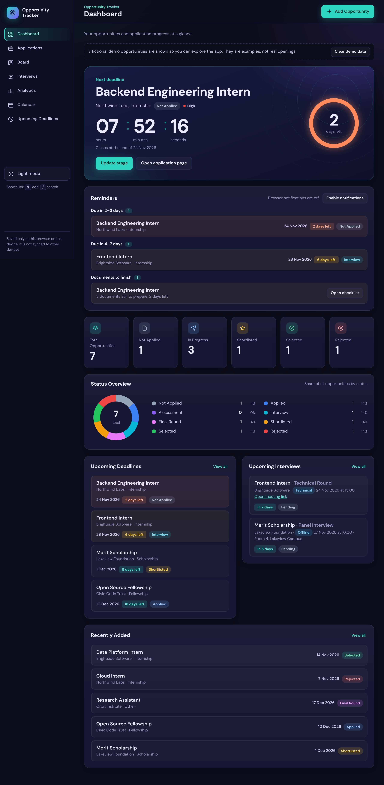
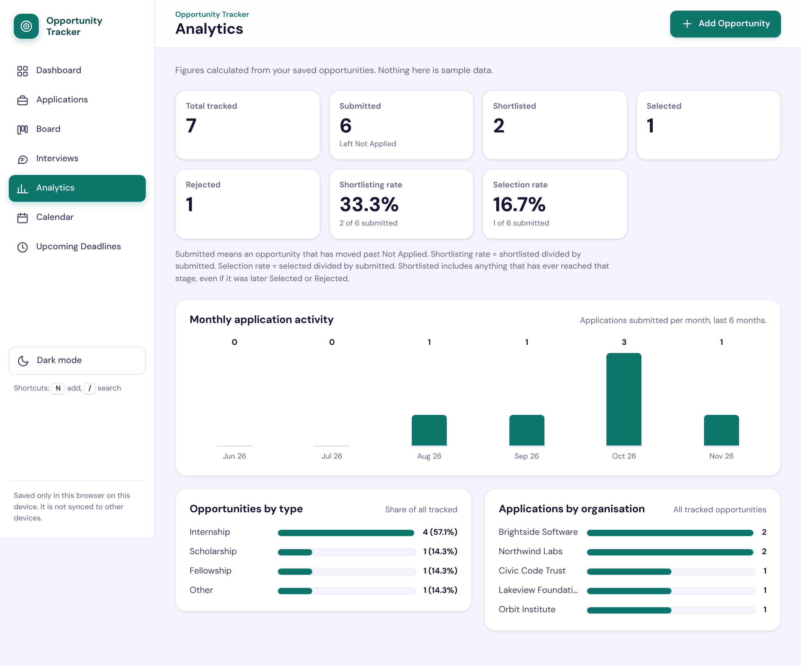
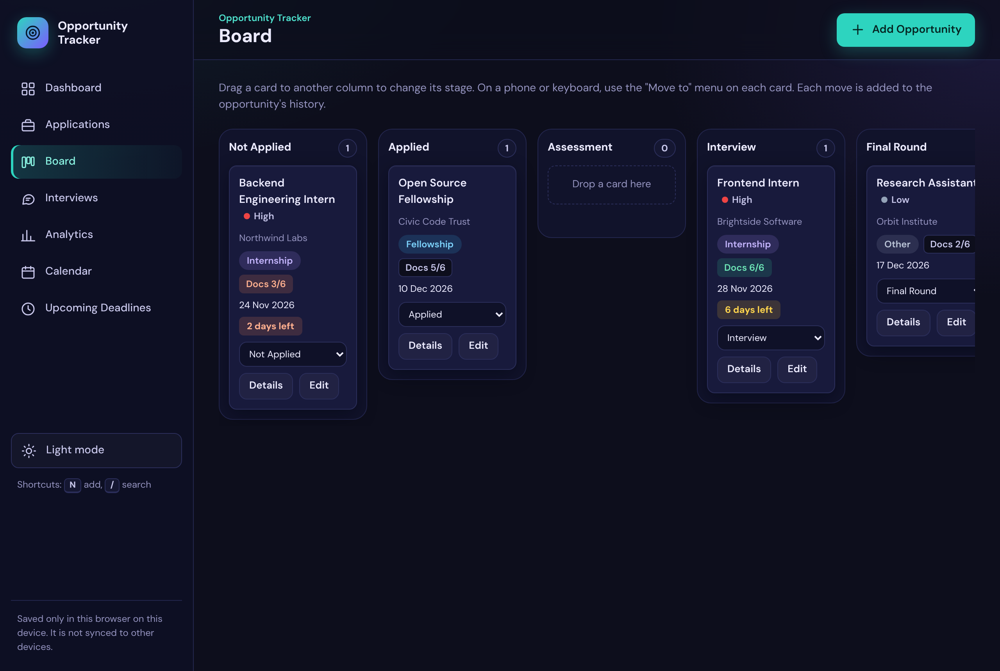
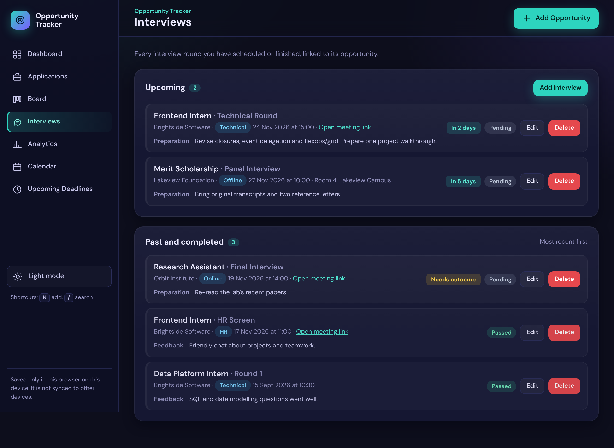
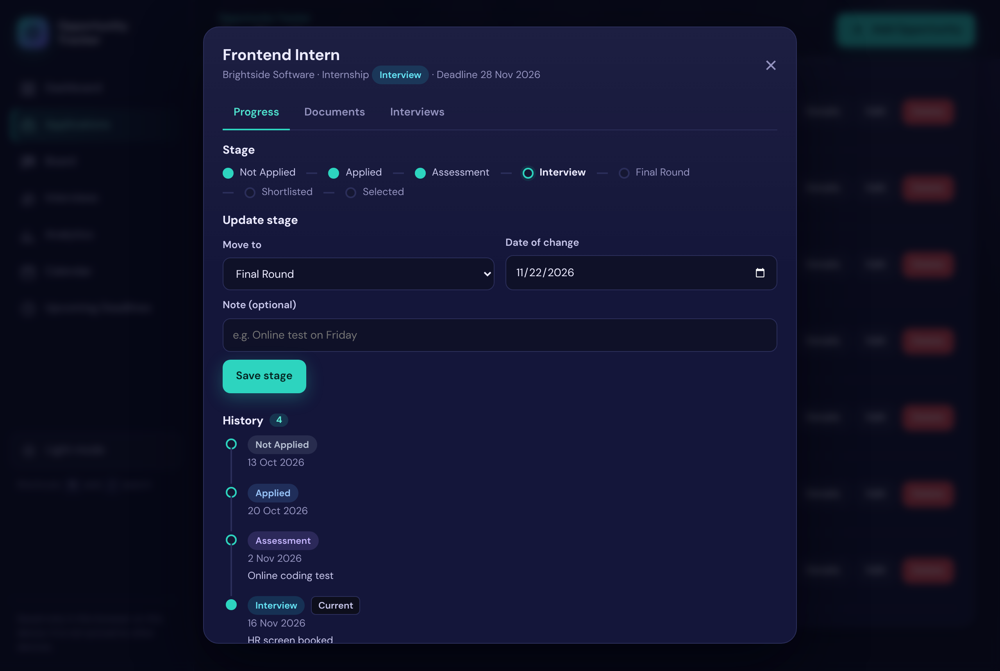
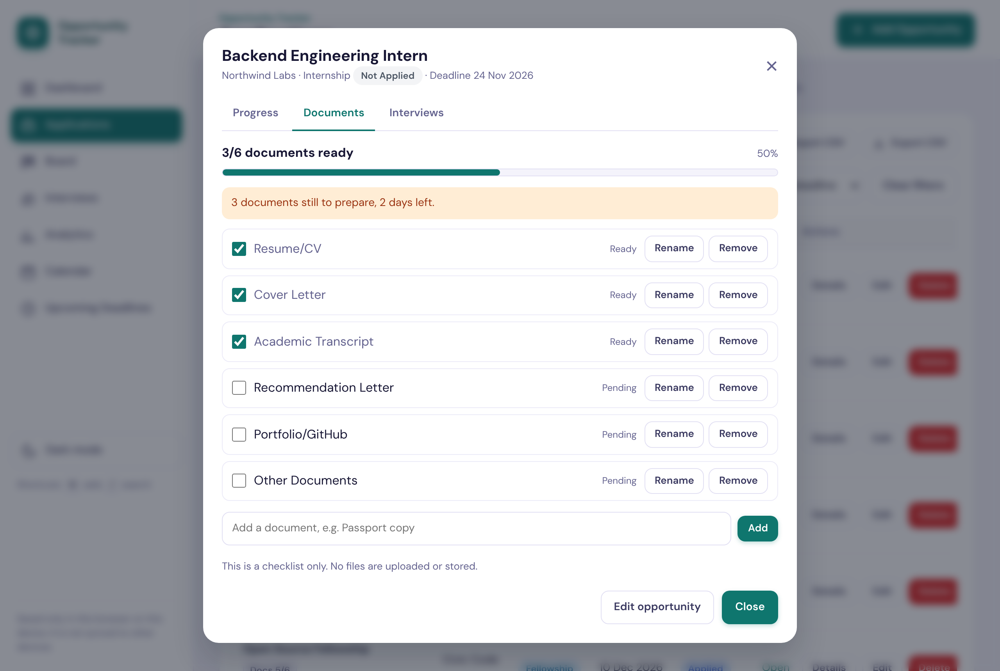
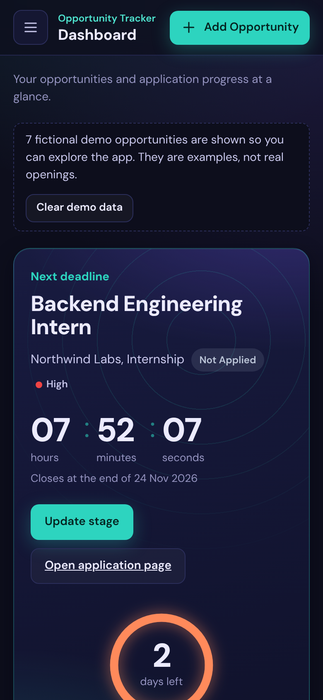
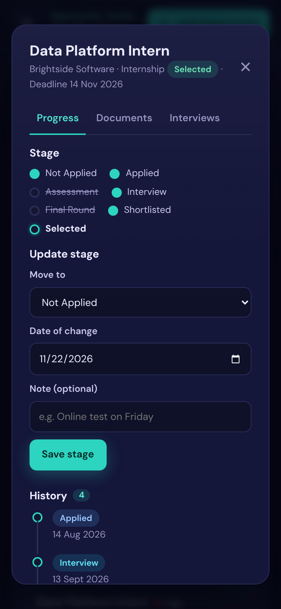

# Opportunity Tracker

A single-page web app for students to track internships, scholarships, fellowships and other opportunities from "found it" to "selected": deadlines, application stages with history, document checklists, interviews and simple analytics. Built with plain **HTML, CSS and vanilla JavaScript**. Data stays in the browser's **LocalStorage**. There is no backend, database, login or external API.

[🌐 Live Demo](https://divyacodehub.github.io/opportunity-tracker/) | [💻 GitHub Repository](https://github.com/divyacodehub/opportunity-tracker)

## Problem it solves

Students juggle many applications at once, each with a different deadline, a different set of documents and several interview rounds. Spreadsheets and notes get out of date. This app keeps everything in one place and shows what needs attention next.

## Screenshots

These screenshots were captured from the running app in Chrome on a genuine first visit, so they show the built-in **fictional demo data** (see below). The organisations and roles are invented and are not real openings.

| | |
|---|---|
|  |  |
|  |  |
|  |  |
|  |  |

## Demo data on the first visit

A brand-new visitor sees a populated app instead of an empty one. On the very first visit (no saved list in LocalStorage) the app adds **7 fictional demo opportunities**: Backend Engineering Intern (Northwind Labs), Frontend Intern (Brightside Software), Merit Scholarship (Lakeview Foundation), Open Source Fellowship (Civic Code Trust), Research Assistant (Orbit Institute), Cloud Intern (Northwind Labs, rejected) and Data Platform Intern (Brightside Software, selected). They include stage history, checklists and interviews.

- They are clearly labelled: a banner on the Dashboard and a note in each record say they are fictional examples.
- Their dates are relative to the visitor's first-visit date (for example, the first deadline is 2 days away), so a visitor on any day sees upcoming deadlines rather than outdated ones.
- Demo data is added **only once**. Existing data is never overwritten or mixed with demo data. If you delete a demo record or everything, it is not brought back on refresh. "Clear demo data" on the Dashboard removes the demo records (any demo record you edit becomes yours and is kept).
- Demo records never trigger browser notifications.

## Features

**Applications**
- Add, edit and delete opportunities (name, organisation, type, deadline, link, status, priority, notes) with validation and a delete confirmation.
- Undo for 7 seconds after a delete (the whole record comes back, including its history, checklist and interviews).
- Search, filters (type, status, priority, "In progress" group) and sorting (earliest / latest deadline, high priority first).
- Table on desktop, cards on phones.

**Stages and history**
- Eight stages: Not Applied, Applied, Assessment, Interview, Final Round, Shortlisted, Selected, Rejected.
- Open any opportunity's **Details** dialog (click its name or use Details). The **Progress** tab shows a step tracker, an "Update stage" form (date and optional note) and a dated history timeline.
- Stage changes also record from the edit form, the Board menu and drag and drop. Dates cannot be in the future or earlier than the previous dated change.
- Records saved before this feature show "Date not recorded" for their first history entry.

**Reminders**
- Dashboard **Reminders** panel: Overdue, Due today, Due tomorrow, Due in 2-3 days, Due in 4-7 days, plus "Documents to finish" for applications not yet sent whose deadline is within 7 days.
- Optional **browser notifications**. Nothing is requested until you click "Enable notifications". Each deadline notifies once per step (7, 3, 1 day, due today, overdue). You can turn them off and on. If the browser does not support notifications, or permission is blocked, the panel says so and the on-page reminders still work.

**Document checklist**
- Six defaults (Resume/CV, Cover Letter, Academic Transcript, Recommendation Letter, Portfolio/GitHub, Other Documents), per opportunity.
- Tick done/pending, add custom items, rename and remove items, "3/6 documents ready" with a progress bar. Duplicate names are blocked. This is a checklist only: no files are uploaded.

**Interviews**
- Interviews page (Upcoming / Past and completed) and an Upcoming Interviews panel on the dashboard.
- Fields: date, time, round, type (Online, Offline, Technical, HR, Other), meeting link or location, preparation notes, questions asked, outcome (Pending, Passed, Failed, Cancelled) and feedback. Multiple rounds per opportunity (round names must be unique per opportunity), edit, delete (with undo), and an optional "also move to the Interview stage".
- Past interviews are highlighted; past interviews still marked Pending are flagged "Needs outcome".

**Analytics** (calculated from saved records, nothing hard-coded)
- Total tracked, submitted, shortlisted, selected, rejected, shortlisting rate and selection rate (both divided by *submitted*, one decimal, shown as "-" when nothing has been submitted).
- Monthly applications (last 6 months), opportunities by type, and applications by organisation (top 8, case-insensitive grouping).

**Existing features kept**: dashboard stats and donut chart, Kanban board with drag and drop, calendar, upcoming/overdue deadlines, `.ics` export, CSV import/export, dark and light themes, live next-deadline countdown, keyboard shortcuts (N, /), responsive mobile navigation.

## Technologies

HTML5, CSS3, vanilla JavaScript (ES6+), LocalStorage, inline SVG for charts. No libraries or build step. Optional Google Fonts (falls back to system fonts offline).

## Project structure

```
opportunity-tracker/
  index.html     page structure, dialogs, Content-Security-Policy meta tag
  style.css      all styles (light and dark)
  script.js      data model + logic, rendering, events
  README.md
  SECURITY.md    security notes and recommended response headers
  screenshots/   images used in this README
```

## How to run

1. Keep `index.html`, `style.css` and `script.js` in the same folder.
2. Open the folder in VS Code and use **Live Server** ("Go Live"), or double-click `index.html`.
3. Data is saved automatically in your browser. Browser notifications work best from `http://localhost`/`127.0.0.1` or HTTPS; some browsers block them on `file://` pages.

## Deploy to GitHub Pages

1. Create a GitHub repository and upload `index.html`, `style.css`, `script.js`, `README.md`, `SECURITY.md` and the `screenshots/` folder to the repository root.
2. Open the repository **Settings > Pages**. Under "Build and deployment", choose **Deploy from a branch**, select the `main` branch and the `/ (root)` folder, then **Save**.
3. After a minute the site is live at `https://<your-username>.github.io/<repository-name>/`.

All file paths are relative, so the app works from a repository sub-path. Each visitor gets their own private data and demo data, stored in their own browser. Nothing is uploaded to GitHub. GitHub Pages cannot set custom HTTP headers; see [SECURITY.md](SECURITY.md).

## LocalStorage behaviour and limitations

- Keys: `opportunityTracker.applications` (records), `opportunityTracker.theme`, `opportunityTracker.notifications` (on/off and which reminders were already sent), `opportunityTracker.demoSeeded` (remembers that demo data was already offered, so it is never added again).
- Data is stored **only in the current browser on the current device and is not synced** between devices or browsers.
- Data is per browser and per site address. Another browser, a private window, or a different address (`localhost` vs `127.0.0.1`) starts empty. Clearing site data deletes it. Export a CSV regularly as a backup.
- **Upgrade from the earlier version**: old records are upgraded automatically on first load. A raw copy of the old data is kept once under `opportunityTracker.applications.backup`. Unreadable data is kept under `...applications.corrupt` and the app starts empty instead of crashing. If storage is blocked, the app still runs but nothing is saved, and it tells you.
- Saved data is treated as untrusted: ids must be plain, unknown status/type values become "Not Applied"/"Other", links that are not http(s) are dropped, and records with an invalid deadline are skipped.
- **CSV** keeps the same columns as before (`Name,Organisation,Type,Deadline,Status,Link,Notes,Priority`). It does **not** contain stage history, checklists or interviews. An imported opportunity starts with a fresh history and default checklist.
- Notifications only fire while the app is open in a browser tab (the app checks every 5 minutes and when you return to the tab). There is no server, so nothing can notify you when the page is closed.
- Limit: LocalStorage typically holds about 5 MB.

## Security summary

See [SECURITY.md](SECURITY.md). In short: all user text is HTML-escaped (including quotes), links are limited to http/https with `rel="noopener noreferrer"`, CSV import is validated and size-limited and export guards against spreadsheet formula injection, stored data is validated on load, and a Content-Security-Policy is included.

## Future improvements

- Optional export/import of the full data (including history, checklists and interviews) as JSON.
- Edit or delete individual history entries.
- Attach reminders to interview times.
- Installable offline app (service worker) so notifications can work with the tab closed.
